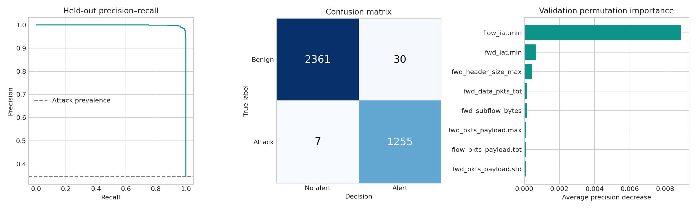

# NetGuard: experiment results

## Experiment definition

Offline supervised intrusion detection on UCI RT-IoT2022. The input is a completed
bidirectional flow-feature record, not raw packets. There are 81 model features
(79 numeric, 2 categorical). Three normal-device labels map to Benign; nine attack
labels retain their source spelling. Results below were produced by the supplied
training code, not illustrative or fabricated metrics.

## Data audit

| Stage | Rows |
|---|---:|
| Raw source | 123,117 |
| Conflicting-label rows removed | 611 |
| Further exact-feature duplicates removed | 104,244 |
| Final unique cohort | 18,262 |
| Train | 10,957 |
| Validation | 3,652 |
| Test | 3,653 |

Source/destination ports, row index and target are excluded. Hashes cover only
retained input features. Ten feature-vector groups have conflicting collapsed
family labels; all 611 rows in those groups are removed, then same-vector rows are
deduplicated. Exact hashes do not overlap across splits. This deterministic cohort
cleaning uses label consistency before splitting; the final benchmark is a cleaned
cohort, not an untouched sample of raw production traffic.

Deduplication changes attack prevalence substantially. A dominant flood has many
repeated patterns, so volume-weighted raw accuracy and unique-pattern accuracy are
not the same quantity. No session/time identifiers are available for a stronger split.

## Selection protocol

60/20/20 stratified split on collapsed attack family, random seed 42. Preprocessing
is fit on training only. Candidates: majority baseline, class-balanced logistic
regression with signed log transformation and scaling, and class-balanced random
forest (180 trees, maximum depth 20, minimum leaf size 2).

Each threshold maximizes validation F2 among candidates with validation false-positive
rate at most 1%. The non-dummy model with highest eligible validation F2 is selected.
No test result is used in threshold or model selection. Models remain trained on the
training partition only; no train-plus-validation refit occurs.

**Selected: Random forest. Exact threshold: 0.531748169685.**

## Held-out binary results

| Metric | Result |
|---|---:|
| Average precision | 0.999013 |
| ROC AUC | 0.999493 |
| Attack precision | 97.67% |
| Attack recall | 99.45% |
| F1 | 0.985473 |
| F2 | 0.990842 |
| False-positive rate | 1.25% |
| True positives / false negatives | 1255 / 7 |
| True negatives / false positives | 2361 / 30 |

The test FPR exceeds the 1% validation constraint: the constraint is a model-selection
target, not a guarantee on new traffic. The test contains 1,262 attack and 2,391 benign
unique patterns, a distribution shaped by deduplication.

## Baselines on the same test partition

| Model | AP | Recall | Precision | FPR |
|---|---:|---:|---:|---:|
| Majority baseline | 0.345469 | 0.00% | 0.00% | 0.00% |
| Logistic regression | 0.979812 | 93.19% | 98.00% | 1.00% |
| Random forest | 0.999013 | 99.45% | 97.67% | 1.25% |

The majority baseline uses the training prior as a constant score; under the FPR
constraint it emits no alerts. Precision is reported as zero when there are no
positive predictions. It is an explicit reference, not a useful detector.

## Per-family binary detection

| True family | Test support | Alert rate |
|---|---:|---:|
| ARP_poisioning | 1058 | 99.53% |
| Benign | 2391 | 1.25% |
| DDOS_Slowloris | 107 | 100.00% |
| DOS_SYN_Hping | 11 | 100.00% |
| Metasploit_Brute_Force_SSH | 7 | 100.00% |
| NMAP_FIN_SCAN | 1 | 100.00% |
| NMAP_OS_DETECTION | 15 | 100.00% |
| NMAP_TCP_scan | 8 | 100.00% |
| NMAP_UDP_SCAN | 39 | 94.87% |
| NMAP_XMAS_TREE_SCAN | 16 | 100.00% |

For Benign, alert rate means false-positive rate; for attack families it means recall.
A 100% recall with one or seven examples is weak evidence. Binary detection of a
family does not mean the separate family classifier names it correctly.

## Secondary family classifier

A separate training-only random forest (140 trees) classifies nine known attack
families plus Benign. Macro-F1: **0.8564**;
weighted-F1: **0.9859**.
The NMAP_FIN_SCAN test sample is not correctly named (family recall 0/1), although
the binary detector flags it. UDP-scan family recall is
74.36%. Dashboard candidate family
uses the highest-scoring non-Benign class for flagged flows, so a candidate may
have a low score. It is a suggestion, never a verified incident label. The standard
classification report instead evaluates the unrestricted argmax over all ten classes.

## Fixed-model uncertainty

300 row bootstrap resamples, seed 42; 95% percentile intervals:

- average_precision: 0.998359–0.999499
- recall: 0.989473–0.998396
- false_positive_rate: 0.008814–0.016994

These intervals do not capture training uncertainty, dataset selection bias or
capture-level correlation. They are not external-generalization confidence bounds.

## Explainability

Validation permutation importance measures average-precision change over three
shuffles. It is diagnostic only, not used to remove features. Correlated fields can
substitute for one another, making individual importance deceptively low.

Per-flow sensitivity replaces one of the top 15 numeric fields with its benign
training median and recomputes the score. The change is not additive, not SHAP and
not causal. Independent replacement can produce physically implausible combinations.

## Limitations and next experiment

- Controlled lab attacks and a limited device mix do not represent enterprise traffic.
- Exact deduplication does not eliminate near duplicates or shared-capture context.
- No reliable time/session/device holdout can be reconstructed from this export.
- Conflicting inputs are removed, so ambiguous observations are underrepresented.
- No synthetic oversampling is applied; class weights do not create rare-class evidence.
- No calibrated probability, zero-day claim, throughput SLA or live feature extractor.
- Global range/category checks are basic data-quality diagnostics, not full drift detection.
- Features summarise completed flows; this is not a claim of per-packet early detection.

The next meaningful experiment is a frozen-model evaluation on independently captured,
time- and device-separated traffic using a verified matching extractor. Compare
alert burden at realistic low attack prevalence before considering operational use.

## Reproducibility

See `source.json` for SHA-256 hashes, `environment.json` for versions,
`split_manifest.csv` for input-hash assignments, `test_predictions.csv` for per-record
outcomes, and `metrics.json` for machine-readable metrics. Source attribution and
license are in `../DATA_LICENSE.md`. Seed and model settings are in `../src/train.py`.
